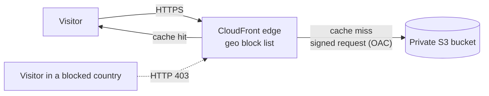

# GeoGate: Region-Restricted Static Website on S3 and CloudFront

**AWS re/Start Capstone Project 3 - status: built and tested.**

> A private Amazon S3 website delivered worldwide through CloudFront, with Russia blocked by a country-level geo-restriction and the block tested over VPN.

## Scenario

Host a **static website on Amazon S3** that is **globally accessible**, but **blocks users in Russia**. Use
**Amazon CloudFront** for performance.

## Solution



- The **S3 bucket is private** (Block Public Access on). Only this CloudFront distribution can read it, through
  **Origin Access Control (OAC)** and a bucket policy that checks the distribution's ARN.
- **CloudFront** caches content at edge locations worldwide, which is the performance win, and applies a
  **geo-restriction block list** containing Russia.
- Price class is **all edge locations**, because cheaper classes leave out Africa, Asia and South America.

Why not S3 static-website hosting directly? It needs a public bucket and HTTP only, and it cannot do geo blocking.
OAC keeps the bucket private and gives HTTPS.

The website itself is in [`website/`](website/): a single-page explainer with an interactive "follow a request"
section, plus a custom error page.

## Results

| # | Test | Expected | Result |
|---|------|----------|--------|
| 1 | Open the CloudFront URL with no VPN (Kenya) | Page loads | Page loaded |
| 2 | Open the same URL through a VPN exit in the Netherlands, with the Netherlands on the block list | HTTP 403 | CloudFront returned 403: "configured to block access from your country" |

**No VPN (Kenya) - allowed**


**VPN in the Netherlands - blocked**


**How the block was tested.** The free VPN tier I used (Proton VPN) has no Russian server, so I added the Netherlands
to the block list as a stand-in. The geo-restriction works the same way for every country code, so a block on the
Netherlands proves the mechanism. After the test I removed the Netherlands, leaving **Russia** as the only blocked country.

CloudFront decides the country from the visitor's IP address using a third-party database, so results depend on where
the VPN exit is, and a small number of IPs can be mapped to the wrong country.

## Issues I ran into

| Problem | Cause | Fix |
|---------|-------|-----|
| Creating the distribution failed with `not authorized to perform: wafv2:CreateWebACL` | The new CloudFront wizard had *Security protections* (AWS WAF) switched on, and the lab account is not allowed to create web ACLs | Went back and created the distribution with security protections off. Geographic restriction is a CloudFront feature and does not need WAF. |
| The CloudFront address showed an XML `AccessDenied` error | No **Default root object** was set. Requesting `/` makes S3 look for an object with an empty name. `/index.html` and `/style.css` worked, which showed the bucket policy was fine | Set **Default root object** to `index.html` under *General > Settings*. |
| Blocked visitors see CloudFront's plain 403 page | No custom error response configured in the console build | Optional: add a 403 error page under *Error pages* pointing to `/error.html` (the CloudFormation template already does this). |

## Build it - console walkthrough

1. **Create a bucket** with a globally unique name. Keep **Block all public access** ON.
2. **Upload** the contents of [`website/`](website/) (`index.html`, `error.html`, `style.css`) to the top level of the bucket.
3. **Create a CloudFront distribution.**
   - Origin: the S3 bucket (choose the bucket, not the website endpoint).
   - Origin access: **Origin access control settings** > create a new OAC with the defaults.
   - Viewer protocol policy: redirect HTTP to HTTPS.
   - Security protections / WAF: **off** (not needed, and some lab accounts cannot create it).
   - Price class: use all edge locations, if the option is shown.
4. **Update the bucket policy.** Copy the policy CloudFront generates (distribution > *Origins* > edit the origin > *Copy policy*)
   into the bucket's *Permissions > Bucket policy*.
5. **Set the default root object** to `index.html` (distribution > *General > Settings > Edit*).
6. **Block Russia.** Distribution > *Security > Geographic restrictions* > **Block list** > add *Russian Federation*.
7. (Optional) *Error pages*: map 403 and 404 to `/error.html`.

## Build it - CloudFormation

```bash
aws cloudformation deploy --template-file cloudformation/static-site.yaml --stack-name capstone3-static-site
./scripts/deploy.sh          # uploads website/ and clears the CDN cache
aws cloudformation describe-stacks --stack-name capstone3-static-site --query "Stacks[0].Outputs"
```

## Update the site after editing the files

Upload the changed files to the bucket (S3 > bucket > *Upload*, overwrite the existing ones), then clear the CDN cache:
CloudFront > distribution > *Invalidations* > *Create invalidation* > `/*`.

## Test it from the command line (optional)

```bash
python3 tools/check_site.py https://dxxxxxxxx.cloudfront.net --show-ip --label "VPN: Netherlands" --log results.md
```

## Clean-up

Disable and delete the distribution, empty the bucket (`aws s3 rm s3://<bucket> --recursive`), then delete the bucket.
With CloudFormation, empty the bucket first, then `aws cloudformation delete-stack --stack-name capstone3-static-site`.

## Possible improvements

- Custom domain with Route 53 and an ACM certificate (the certificate must be issued in us-east-1).
- Add security headers with a CloudFront response-headers policy.
- Deploy automatically with a GitHub Actions workflow that runs `scripts/deploy.sh`.
