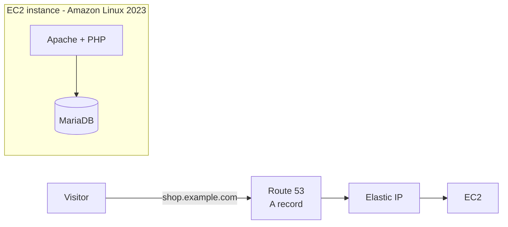

# WordPress site for an e-commerce start-up

## Scenario

An e-commerce start-up wants a website with a **simple interface** and **as little development cost as possible**, plus a
**DNS name**. The solution: host **WordPress on AWS**.

## Solution



WordPress gives the client a ready-made admin dashboard, themes and e-commerce plugins (such as WooCommerce), so there
is no custom development. Everything runs on **one EC2 instance** to keep the cost low:

- **Elastic IP** keeps the address fixed across stop/start, so DNS never breaks.
- **Route 53** record (or any DNS provider) maps the domain to that IP.
- The **security group** opens 80/443 to the world and 22 only to the administrator's IP.
- The database password is **generated on the server** during setup and is not stored in this repo.

| Option | Cost | Trade-off |
|--------|------|-----------|
| **Single EC2 (this project)** | Lowest | One server holds site and database. Back it up. |
| Amazon Lightsail WordPress blueprint | Low, fixed | Even simpler, less AWS-service learning. |
| EC2 + RDS + ALB + Auto Scaling | Higher | Highly available, for when traffic grows. |

## Build it - console walkthrough

1. **Launch EC2.** Amazon Linux 2023, `t3.small` (a `t3.micro` also works), public subnet, your key pair. Security group:
   HTTP 80, HTTPS 443 from anywhere, SSH 22 from **My IP**. In *Advanced details > User data* paste
   [`userdata/wordpress-userdata.sh`](userdata/wordpress-userdata.sh).
2. **Allocate an Elastic IP** and associate it with the instance.
3. **Create the DNS name.** Route 53 > hosted zone for your domain > **A record** `shop.yourdomain.com` > the Elastic IP.
   If you do not own a domain, register one in Route 53, or use a registrar and point its name servers at the hosted zone.
4. **Finish setup in the browser.** After 3-5 minutes open `http://shop.yourdomain.com` and complete the WordPress
   installer (site title, admin user, password). Use the domain, not the IP, so WordPress records the right site URL.
5. **Install a theme and plugin** (for example a shop theme and WooCommerce), then add a sample product.
6. **HTTPS (recommended).** SSH in and run Certbot, or put CloudFront with an ACM certificate in front of the site.

## Build it - CloudFormation

```bash
aws cloudformation deploy \
  --template-file cloudformation/wordpress.yaml \
  --stack-name capstone4-wordpress \
  --parameter-overrides VpcId=vpc-xxxx SubnetId=subnet-xxxx KeyName=my-key \
                        AdminCidr=$(curl -s https://checkip.amazonaws.com)/32
  # optional DNS: DomainName=shop.example.com HostedZoneId=Z123
aws cloudformation describe-stacks --stack-name capstone4-wordpress --query "Stacks[0].Outputs"
```

## Verify it

| Check | Expected | Screenshot |
|-------|----------|------------|
| `http://<domain>` shows the WordPress installer or site | Page loads | `screenshots/wp-install.png` |
| `nslookup <domain>` | Returns the Elastic IP | `screenshots/nslookup.png` |
| `/wp-admin` login | Dashboard opens | `screenshots/wp-dashboard.png` |
| Final storefront with a sample product | Site renders | `screenshots/storefront.png` |

## Clean-up

Terminate the instance, **release the Elastic IP** (idle ones are billed), delete the Route 53 record and hosted zone,
and delete the security group. With CloudFormation: `aws cloudformation delete-stack --stack-name capstone4-wordpress`.

## Possible improvements

- Move the database to Amazon RDS and media to S3 + CloudFront.
- Automate backups with AWS Backup or EBS snapshots on a schedule.
- Add HTTPS with Let's Encrypt or ACM and harden with a WAF.
